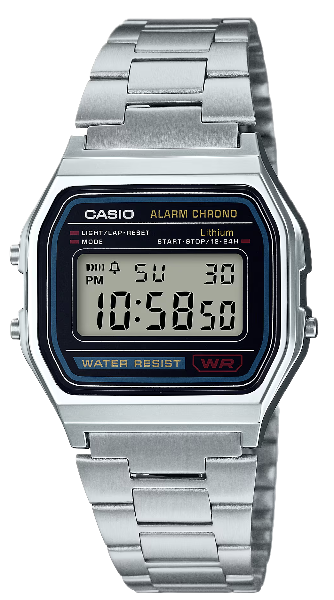

# Casio A158W macOS Desktop Widget (Übersicht)

A faithful, functional macOS desktop widget that recreates the iconic **Casio A158W** digital watch directly on your desktop wallpaper using [Übersicht](https://tracesof.net/uebersicht/).

<p align="center">
  
</p>

---

## 🌟 Key Features

1. **Faithful Visual Design**:
   - Octagonal beveled stainless steel / chrome-plated resin case with authentic metallic grain and highlights.
   - 3-tiered brushed steel bracelet link lugs (top and bottom).
   - Obsidian black bezel plate with iconic cobalt blue accent frames and red function bars.
   - Crisp white `CASIO`, metallic gold `ALARM CHRONO`, `Lithium`, and `WATER RESIST`, plus stylized magenta-red `WR` logo.
   - Authentic reflective grey-green LCD crystal with diagonal glass reflection and faint ghosted unlit segments (`88:88 88`).
   - Pure SVG 7-segment digital font with ~5° italic slant.

2. **Accurate Timekeeping**:
   - Real-time local computer time (hours, minutes, seconds).
   - Day of week (`SU`, `MO`, `TU`, `WE`, `TH`, `FR`, `SA`) and day of month date display.
   - 1-Hz flashing colon separator (`:`).
   - Toggleable **12-Hour** (with `PM` indicator and leading space for single digits) and **24-Hour** display formats.

3. **High-Precision Monotonic Stopwatch (1/100s)**:
   - Measures elapsed time down to 1/100 of a second.
   - Monotonic timing source using `performance.now()`—zero drift, never drops time.
   - Working **Start**, **Stop**, **Reset**, and **Split / Lap Time** (`SPL`) functionality.
   - When split is engaged, the screen freezes on the split time with `SPL` illuminated while the timer runs accurately in the background.

4. **Authentic Micro-LED Backlight**:
   - Classic Casio green micro-LED glow emanating from the left edge of the LCD window.
   - Realistic phosphor/LED decay that smoothly fades over 1.8 seconds.
   - Activated via the top-left pusher, the `LIGHT` dial text, or the `L` key.

5. **Physical-Style Controls & Sound**:
   - 3 clickable metal pushers protruding from the case with tactile depression animations.
   - Dial text labels (`LIGHT`, `MODE`, `START•STOP`) are also clickable!
   - Built-in Web Audio API synthesizer reproducing the authentic 2048 Hz piezo buzzer beep.
   - Mute/unmute toggle via the bell icon or `B` key.

6. **Desktop Friendly & Zero Network Dependencies**:
   - Designed for Übersicht: sits directly on your desktop layer behind application windows without obstruction.
   - Transparent click-through (`pointer-events: none` on outer wrapper, `pointer-events: auto` on the watch) so you can still click desktop files and icons around it.
   - **Draggable**: click and drag anywhere on the watch case to position it anywhere on your desktop. Position is saved automatically in `localStorage`.
   - 100% self-contained—zero external libraries, zero CDN requests, works completely offline.

---

## 📁 Repository Structure

```
casio_widget/
├── casio-a158.widget/          <-- Main Übersicht Widget Folder
│   ├── index.jsx               <-- Self-contained Übersicht widget entry point
│   ├── watch_frame.png         <-- Photorealistic original Casio A158W frame with transparent LCD
│   └── screenshot.png          <-- Preview image
├── demo.png                    <-- Original Casio A158W reference photo
├── install.sh                  <-- Automated installer for Apple Silicon / Intel Mac
├── preview/                    <-- Local interactive browser preview & test bench
│   ├── index.html              <-- Standalone test harness
│   ├── casio-widget.js         <-- Standalone JavaScript controller
│   └── watch_frame.png         <-- Photorealistic watch frame asset
└── README.md                   <-- Full setup and documentation
```

---

## 🚀 Installation on Apple Silicon Mac

### Option 1: Automated 1-Click Install (Recommended)

Open Terminal, navigate to this directory, and run:

```bash
chmod +x install.sh
./install.sh
```

The script will automatically:
1. Detect your Apple Silicon architecture (`arm64`).
2. Verify or install Übersicht via Homebrew (`brew install --cask ubersicht`).
3. Create the Übersicht widgets directory (`~/Library/Application Support/Übersicht/widgets/`).
4. Link `casio-a158.widget` into your Übersicht widgets directory.
5. Launch or restart Übersicht.

---

### Option 2: Manual Installation

#### Step 1: Install Übersicht
If you don't already have Homebrew or Übersicht installed:
- **Using Homebrew**:
  ```bash
  brew install --cask ubersicht
  ```
- **Direct Download**:
  Download the latest DMG from [tracesof.net/uebersicht](https://tracesof.net/uebersicht/), open the DMG, and drag `Übersicht.app` into `/Applications`.

#### Step 2: Copy or Symlink the Widget
The default Übersicht widget folder path on macOS is:
```
~/Library/Application Support/Übersicht/widgets/
```

To create the directory and symlink the widget:
```bash
mkdir -p "$HOME/Library/Application Support/Übersicht/widgets"
ln -s "$(pwd)/casio-a158.widget" "$HOME/Library/Application Support/Übersicht/widgets/casio-a158.widget"
```

#### Step 3: Launch Übersicht
Launch Übersicht from `/Applications/Übersicht.app` or via Terminal:
```bash
open -a Übersicht
```
The Casio A158 watch will immediately appear on your desktop!

---

## 🕹 Controls & Physical Pushers

| Watch Control | Physical Button | Dial Label | Keyboard | Action |
| :--- | :--- | :--- | :---: | :--- |
| **Backlight** | Top-Left Pusher | `LIGHT / LAP • RESET` | <kbd>L</kbd> | Illuminates LCD in green micro-LED glow for 1.8s |
| **Mode Switch**| Bottom-Left Pusher | `MODE` | <kbd>M</kbd> | Cycles between **Timekeeping** and **Stopwatch** (`ST`) |
| **12/24H Toggle**| Bottom-Right Pusher | `START • STOP / 12 • 24H` | <kbd>S</kbd> | *(In Time mode)* Toggles 12-hour (with `PM`) and 24-hour formats |
| **Start / Stop**| Bottom-Right Pusher | `START • STOP / 12 • 24H` | <kbd>S</kbd> | *(In Stopwatch mode)* Starts or stops the monotonic 1/100s chronograph |
| **Lap / Reset** | Top-Left Pusher | `LIGHT / LAP • RESET` | <kbd>R</kbd> | *(In Stopwatch mode)* Freezes split time (`SPL`) while running, or resets to `00:00 00` when stopped |
| **Buzzer Mute** | Bell Icon on LCD | — | <kbd>B</kbd> | Mutes or unmutes the 2048 Hz piezo beep sound |
| **Scale Up** | — | — | <kbd>+</kbd> / <kbd>=</kbd> | Zooms / enlarges watch widget (+10%) |
| **Scale Down** | — | — | <kbd>-</kbd> / <kbd>_</kbd> | Shrinks watch widget (-10%) |
| **Reset Scale** | — | — | <kbd>0</kbd> | Resets watch size to 1.0x standard size |

---

## 🖥 Repositioning, Resizing & Desktop Interaction

- **Drag to Move**: Click anywhere on the watch's silver case (outside the buttons) and drag it to your desired spot on your desktop (e.g. top-right corner, near menu bar, or dock).
- **Interactive Resizing**:
  - Press <kbd>+</kbd> or <kbd>-</kbd> on your keyboard to scale the watch up or down.
  - Hold <kbd>Option</kbd> (or <kbd>Cmd</kbd>) and scroll with your trackpad / mouse wheel over the watch to zoom smoothly.
  - Press <kbd>0</kbd> to return to standard size (1.0x).
- **Default Size Configuration**:
  - You can also change the default base scale permanently by editing `DEFAULT_SCALE` at the top of [`casio-a158.widget/index.jsx`](casio-a158.widget/index.jsx) (e.g., `0.8` for smaller, `1.2` for larger).
- **Position & Scale Memory**: The widget automatically remembers its position and size in macOS `localStorage` across reboots.
- **Desktop Click-Through**: Clicks outside the watch are completely transparent to macOS, allowing you to select desktop icons and files naturally.

---

## ⚙️ Start Automatically at Login

To ensure your Casio clock is always on your desktop whenever your Mac boots:

1. Open **System Settings** on your Mac.
2. Go to **General** ➔ **Login Items & Extensions**.
3. Under **Open at Login**, click the `+` button.
4. Select `/Applications/Übersicht.app` and click **Open**.

---

## 🔧 Troubleshooting & Reloading

- **Reloading Widgets**:
  Click the coffee cup icon for Übersicht in the macOS menu bar and click **"Refresh all Widgets"** (or press <kbd>Cmd</kbd> + <kbd>R</kbd>).
- **Opening Widget Folder**:
  From the Übersicht menu bar item, click **"Open Widgets Folder"** to inspect installed widgets.
- **Viewing Errors**:
  If a widget errors, click the Übersicht menu bar icon and select **"Show Debug Console"** to view WebKit inspection logs.
- **Reset Position**:
  If you ever drag the widget off-screen or want to reset it back to default top-right:
  Open Übersicht's Debug Console or Terminal and run:
  ```javascript
  localStorage.removeItem('casio_a158_pos');
  ```
  Then refresh widgets.
